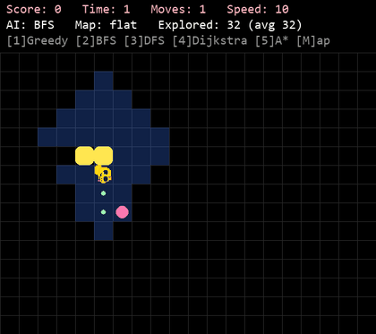

# AI Snake 🐍

[](https://python.org)

A Snake game where the snake plays by itself: an AI uses search (Greedy, BFS, DFS, Dijkstra
and A*) to find its way to the apples, also on rough terrain where some tiles cost more time.



---

## 🚀 Features

- **Five search AIs:** Greedy, BFS, DFS, Dijkstra and A*. Switch between them while the
  game is running to compare them on the same board.
- **Terrain with time costs:** grass (1), sand (2), mud (5) and rock (wall). Maps are plain
  text files, and the snake moves slower on expensive terrain.
- **Search visualisation:** explored tiles (blue) and the planned path (green dots) are
  drawn on the board.
- **Benchmark without a window:** plays many games per AI with the same seeds and prints
  comparison tables (apples, time, moves, explored tiles per move).

## 🛠️ Installation

Ensure you have [Python 3.10+](https://python.org/downloads/) installed.

### 1. Clone the repository
```bash
git clone https://github.com/MadCowVN/snake-ai.git
cd snake-ai
```

### 2. Set up a virtual environment (Recommended)
```bash
# Create the environment
python -m venv venv

# Activate it (Windows)
venv\Scripts\activate

# Activate it (macOS/Linux)
source venv/bin/activate
```

### 3. Install dependencies
```bash
pip install --upgrade pip
pip install -r requirements.txt
```

## 💻 Usage

### Play the game
```bash
python main.py
```

| Key | Action |
|-----|--------|
| `S` | Start (in the menu) |
| `1` `2` `3` `4` `5` | AI: Greedy, BFS, DFS, Dijkstra, A* |
| `M` | Next map (flat, mud river, rocky desert, swamp roads) |
| `V` | Show / hide the search |
| `SPACE` | Pause |
| `UP` / `DOWN` | Faster / slower |
| `R` | Restart |
| `Q` / `ESC` | Quit |

### Compare the AIs
```bash
python benchmark.py
```
Part 1 compares Greedy, BFS and DFS on the flat board (50 games each, until the snake dies).
Part 2 compares BFS, Dijkstra and A* on every map (30 games each, until 30 apples).
Every AI gets the same seeds, so the comparison is fair. It takes about 40 seconds.

### As an Imported Module
```python
from game import Snake, Food, COLS, ROWS, load_map, rocks_of
from ai import astar

# Load a map: terrain[y][x] = time cost of the tile (None = rock)
terrain = load_map("maps/1_mud_river.txt")
snake = Snake()
food = Food(snake.body, rocks=rocks_of(terrain))

# Ask the AI for the next move
direction, explored, path = astar(snake.body, food.position, COLS, ROWS, terrain)
print(f"Move {direction}, path of {len(path)} tiles, explored {len(explored)} tiles")
```

### Project structure

| File | What it does |
|------|--------------|
| `game.py` | `Snake` and `Food` classes, terrain and map loading. |
| `ai.py` | The AIs. Each one returns `(direction, explored, path)`. |
| `main.py` | Menu, game loop and drawing (pygame). |
| `benchmark.py` | Plays many games per AI without drawing and prints tables. |
| `maps/` | Terrain maps, 20 x 15 characters: `.` grass, `:` sand, `~` mud, `#` rock. |
| `assets/` | Snake head picture and sounds. |
| `screenshots/` | Pictures for the report and the demo GIF. |
| `report/` | The report (`report.pdf`, made from `report.html`). |

## 🧪 Running Tests

This project has no automated `pytest` tests yet. `benchmark.py` is the main check: it plays
hundreds of games without a window and prints the results for every AI.

```bash
python benchmark.py
```

## 🤝 Contributing

Contributions make the open-source community an amazing place to learn, inspire, and create.

1. Fork the Project
2. Create your Feature Branch (`git checkout -b feature/AmazingFeature`)
3. Commit your Changes (`git commit -m 'Add some AmazingFeature'`)
4. Push to the Branch (`git push origin feature/AmazingFeature`)
5. Open a Pull Request
